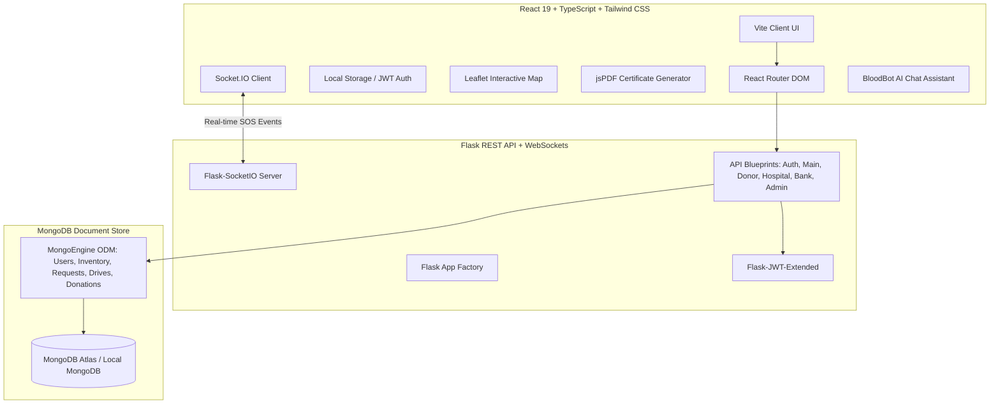

# 🩸 BloodBridge - Complete Project Documentation & Details

> **A real-time, cloud-enabled healthcare platform bridging the critical gap between blood donors, hospitals, and blood banks to save lives without delay.**

---

## 📌 अनुक्रमणिका (Table of Contents)
1. [प्रकल्पाचा सारांश व उद्देश (Project Overview & Vision)](#1-प्रकल्पाचा-सारांश-व-उद्देश-project-overview--vision)
2. [समस्या व उपाय (Problem Statement & Solution)](#2-समस्या-व-उपाय-problem-statement--solution)
3. [सिस्टम आर्किटेक्चर (System Architecture)](#3-सिस्टम-आर्किटेक्चर-system-architecture)
4. [वापरलेले तंत्रज्ञान (Technology Stack)](#4-वापरलेले-तंत्रज्ञान-technology-stack)
5. [युझर रोल्स व कार्यपद्धती (Stakeholders & Workflows)](#5-युझर-रोल्स-व-कार्यपद्धती-stakeholders--workflows)
6. [प्रमुख वैशिष्ट्ये (Key Features & Innovations)](#6-प्रमुख-वैशिष्ट्ये-key-features--innovations)
7. [डेटाबेस मॉडेल्स (Database Schema & Models)](#7-डेटाबेस-मॉडेल्स-database-schema--models)
8. [REST API माहिती (REST API Endpoints)](#8-rest-api-माहिती-rest-api-endpoints)
9. [प्रकल्प सुरू करण्याचे टप्पे (Installation & Setup Guide)](#9-प्रकल्प-सुरू-करण्याचे-टप्पे-installation--setup-guide)
10. [डिफॉल्ट लॉगिन क्रेडेंशियल्स (Default Test Accounts)](#10-डिफॉल्ट-लॉगिन-क्रेडेंशियल्स-default-test-accounts)

---

## 1. प्रकल्पाचा सारांश व उद्देश (Project Overview & Vision)
अपघात, तातडीच्या शस्त्रक्रिया, कर्करोग उपचार किंवा बाळंतपणाच्या वेळी रक्ताची त्वरित गरज भासते. पारंपारिक पद्धतींमध्ये हॉस्पिटलचे कर्मचारी फोन करून ब्लड बँकांमध्ये रक्त शोधतात, ज्यामध्ये मौल्यवान वेळ वाया जातो.

**BloodBridge** ही एक आधुनिक वेब-सिस्टीम आहे, जी:
* सर्व ब्लड बँकांमधील रक्ताचा साठा (A+, A-, B+, B-, AB+, AB-, O+, O-) लाईव्ह आणि डिजिटल ठेवते.
* हॉस्पिटलला आपत्कालीन परिस्थितीत **Emergency SOS Alert** पाठवण्याची सोय देते.
* जवळच्या आणि रक्तगट जुळणाऱ्या दात्यांना (Donors) **Socket.IO** द्वारे स्क्रीनवर त्वरित सायरन/अलर्ट पाठवते.
* दात्याचा रक्तदानाचा संपूर्ण प्रवास ट्रॅक करते आणि त्यांना तात्काळ **Certificate of Appreciation (PDF)** प्रदान करते.

---

## 2. समस्या व उपाय (Problem Statement & Solution)

| पारंपारिक पद्धत (Traditional Issues) | BloodBridge चा आधुनिक उपाय (Our Solution) |
| :--- | :--- |
| **फोनवरून चौकशी:** रक्ताची गरज असताना अनेक ब्लड बँकांना कॉल करावे लागतात. | **One-Click Emergency Broadcast:** हॉस्पिटल एका क्लिकवर आपत्कालीन अलर्ट ब्रॉडकास्ट करू शकते. |
| **दात्यांना फीडबॅक नाही:** दात्याला कधीच कळत नाही की त्याच्या रक्ताचा उपयोग झाला का. | **Live Blood Journey Tracker:** ५ टप्प्यांचा लाईव्ह ट्रॅकर (Donated $\rightarrow$ Tested $\rightarrow$ Stored $\rightarrow$ Dispatched $\rightarrow$ Saved a Life). |
| **अचूकतेचा अभाव:** रक्ताचा साठा वेळेवर न नोंदवल्याने मुदत संपून रक्त वाया जाते. | **डिजिटल इन्व्हेंटरी आणि AI शॉर्टेज फोरकास्टिंग:** रिअल-टाइम स्टॉक आणि भविष्यातील तुटवड्याचा अंदाज. |
| **दात्यांचे कौतुक नाही:** रक्तदात्यांना कोणतीही तत्काळ पोचपावती किंवा बॅज मिळत नाही. | **PDF सर्टिफिकेट व बॅजेस:** ऑटोमॅटिक डाउनलोड होणारे सर्टिफिकेट आणि ब्रॉन्झ/सिल्व्हर/गोल्ड बॅजेस. |

---

## 3. सिस्टम आर्किटेक्चर (System Architecture)



---

## 4. वापरलेले तंत्रज्ञान (Technology Stack)

### 🎨 फ्रंटएंड (Frontend)
* **React 19 & TypeScript:** आधुनिक कंपोनंट-बेस्ड स्ट्रक्चर आणि टाईप-सेफ्टी.
* **Vite 8:** हाय-स्पीड बिल्ड टूल आणि डेव्हलपमेंट सर्व्हर.
* **Tailwind CSS 3.4:** मॉडर्न कार्ड्स, सॉफ्ट शॅडोज (`rounded-2xl`, `rounded-3xl`) आणि रिस्पॉन्सिव्ह डिझाइन.
* **Framer Motion:** स्मूथ पेज ट्रान्झिशन्स आणि कार्ड ॲनिमेशन्स.
* **Leaflet & React-Leaflet:** ५ किमी परिघातील दात्यांचे लोकेशन दाखवणारा इंटरॲक्टिव्ह नकाशा.
* **Recharts:** ब्लड बँकेच्या मागणी आणि पुरवठ्याचे चार्ट्स (Area Charts).
* **jsPDF & html2canvas:** रक्तदात्यांसाठी तत्काळ अधिकृत PDF सर्टिफिकेट जनरेशन.
* **Socket.IO Client:** रिअल-टाइम इमर्जन्सी नोटिफिकेशन्स.
* **BloodBot:** रक्तदानाची माहिती देणारा स्मार्ट चॅटबॉट.

### ⚙️ बॅकएंड (Backend)
* **Python 3.12 & Flask:** RESTful API आर्किटेक्चर.
* **Flask-MongoEngine:** MongoDB साठी ऑब्जेक्ट-डॉक्युमेंट मॅपर (ODM).
* **Flask-JWT-Extended:** सुरक्षित टोकन-बेस्ड ऑथेंटिकेशन (२४ तासांची वैधता).
* **Flask-SocketIO:** रिअल-टाइम द्वि-मार्गी WebSocket संप्रेषण.
* **Flask-CORS:** सुरक्षित क्रॉस-ओरिजिन रिसोर्स शेअरिंग.
* **Werkzeug:** सुरक्षित पासवर्ड हॅशिंग (`pbkdf2:sha256`).

### 🗄️ डेटाबेस (Database)
* **MongoDB:** MongoDB Atlas (Cloud) किंवा Local MongoDB Community Server.

---

## 5. युझर रोल्स व कार्यपद्धती (Stakeholders & Workflows)

### 1. 🦸‍♂️ रक्तदाता (Blood Donor)
* स्वतःचा रक्तदान इतिहास (Donation History) तपासणे.
* रक्ताचा लाईव्ह प्रवास ट्रॅक करणे (**Live Blood Journey Tracker**).
* रक्तदान केल्यावर **Certificate of Appreciation (PDF)** डाउनलोड करणे.
* विविध पातळीचे बॅजेस मिळवणे (**Bronze Saver, Silver Hero, Gold Lifesaver**).
* हॉस्पिटलकडून आलेल्या इमर्जन्सी अलर्ट्सना त्वरित प्रतिसाद देणे.
* **BloodBot** शी चॅट करून पात्रता तपासणे.

### 2. 🏥 हॉस्पिटल (Hospital)
* रक्ताची इमर्जन्सी रिक्वेस्ट तयार करणे (Blood Group व Units).
* **Broadcast Emergency SOS Alert:** एका क्लिकवर जुळणाऱ्या दात्यांना सायरन/अलर्ट पाठवणे.
* **Regional Donor Map:** हॉस्पिटलच्या ५ किमी परिसरात उपलब्ध असणारे दाते नकाशावर पाहणे.
* आपल्या रिक्वेस्ट्सचे स्टेटस (`PENDING`, `ACCEPTED`, `FULFILLED`) तपासणे.

### 3. 🩸 ब्लड बँक (Blood Bank)
* आठही रक्तगटांचा (A+, A-, B+, B-, AB+, AB-, O+, O-) रिअल-टाइम साठा नियंत्रित करणे.
* साठा कमी झाल्यास रंगीत अलर्ट्स (`good`, `low`, `critical`) पाहणे.
* रक्तदान शिबिरे (Blood Donation Drives) शेड्यूल करणे.
* ब्लड युनिट्ससाठी ट्रॅक करण्यायोग्य **QR Codes** जनरेट करणे.
* **AI Shortage Forecasting** चार्ट्सद्वारे भविष्यातील तुटवड्याचा अंदाज घेणे.

### 4. 🛡️ ॲडमिनिस्ट्रेटर (Admin)
* सिस्टीममधील सर्व पेंडिंग रिक्वेस्ट्स, शिबिरे आणि दात्यांचे आकडे पाहणे.
* हॉस्पिटलच्या विनंत्या तपासून मंजूर (Accept) किंवा नामंजूर (Reject) करणे.
* दात्यांच्या रक्तदानाची पडताळणी करून ब्लड बँकेच्या साठ्यात भर घालणे.

---

## 6. प्रमुख वैशिष्ट्ये (Key Features & Innovations)

1. **रिअल-टाइम Socket.IO SOS अलर्ट:**
   हॉस्पिटलने विनंती पोस्ट करताच बॅकएंडवरून `emergency_alert` इव्हेंट ट्रिगर होतो आणि दात्याच्या स्क्रीनवर थेट पॉपअप सायरन वाजतो.
2. **इंटरॲक्टिव्ह रिजनल मॅप (Leaflet):**
   हॉस्पिटलभोवती ५ किमीचा कव्हरेज सर्कल आणि आजूबाजूच्या दात्यांचे रक्तगट व अंतरासह पिन पॉइंट्स.
3. **५-टप्प्यांचा ब्लड ट्रॅकर:**
   Donated $\rightarrow$ Lab Tested $\rightarrow$ Stored $\rightarrow$ Dispatched $\rightarrow$ Saved a Life.
4. **ऑटोमॅटिक PDF सर्टिफिकेट:**
   दात्याच्या नावाचे, तारखेचे आणि स्वाक्षरीसह उच्च दर्जाचे प्रशंसापत्र त्वरित डाउनलोड.
5. **AI शॉर्टेज फोरकास्टिंग:**
   मागील डेटाच्या आधारे पुढील दिवसांत कोणत्या रक्तगटाची कमतरता भासू शकते याचा रेखीय आलेख.

---

## 7. डेटाबेस मॉडेल्स (Database Schema & Models)

* **`User` / `Hospital` / `BloodBank`:** युझरची माहिती, पासवर्ड हॅश, संपर्क, भूमिका (`role`), पत्ता, रक्तगट.
* **`BloodInventory`:** ब्लड बँकेचा साठा (`blood_type`, `units_available`).
* **`BloodRequest`:** हॉस्पिटलची मागणी (`blood_type`, `units_needed`, `priority`, `status`, `deadline`).
* **`BloodDrive`:** रक्तदान शिबिर (`title`, `location`, `start_date`, `end_date`, `target_donors`).
* **`Donation`:** दात्याने केलेले रक्तदान (`donor`, `blood_type`, `units`, `status`, `donation_date`).
* **`Notification`:** दात्यांसाठी इमर्जन्सी मेसेज व अलर्ट्स (`is_read`, `created_at`).

---

## 8. REST API माहिती (REST API Endpoints)

| पद्धत (Method) | एंडपॉइंट (Endpoint) | वर्णन (Description) | ऑथेंटिकेशन (Auth) |
| :--- | :--- | :--- | :--- |
| `POST` | `/api/auth/register/<type>` | डोनर, हॉस्पिटल किंवा ब्लड बँकेची नोंदणी | नाही |
| `POST` | `/api/auth/login` | लॉगिन करून JWT Bearer Token मिळवणे | नाही |
| `GET` | `/api/auth/me` | चालू युझरची प्रोफाइल मिळवणे | JWT Token |
| `GET` | `/api/main/home` | होम पेजची आकडेवारी व इमर्जन्सी रिक्वेस्ट्स | नाही |
| `GET` | `/api/donor/dashboard` | डोनरचा इतिहास व आगामी शिबिरे | JWT (Donor) |
| `GET` | `/api/donor/notifications`| न वाचलेले अलर्ट्स | JWT (Donor) |
| `GET` | `/api/hospital/dashboard` | हॉस्पिटलच्या चालू विनंत्या | JWT (Hospital) |
| `POST`| `/api/hospital/create-emergency-request` | इमर्जन्सी रिक्वेस्ट व Socket.IO अलर्ट | JWT (Hospital) |
| `GET` | `/api/blood-bank/dashboard` | ब्लड बँकेचा साठा व शिबिरे | JWT (Bank/Admin) |
| `POST`| `/api/blood-bank/update-inventory` | रक्ताच्या साठ्यात बदल करणे | JWT (Bank) |
| `POST`| `/api/blood-bank/schedule-drive` | नवीन रक्तदान शिबिर आयोजित करणे | JWT (Bank/Admin) |
| `GET` | `/api/admin/dashboard` | ॲडमिनसाठी संपूर्ण सिस्टीमचा ओव्हरव्ह्यू | JWT (Admin) |

---

## 9. प्रकल्प सुरू करण्याचे टप्पे (Installation & Setup Guide)

### पायरी १: डिपेंडन्सीज इन्स्टॉल करा
```bash
# Python पॅकेजेस
pip install -r requirements.txt

# React फ्रंटएंड पॅकेजेस
cd frontend
npm install
cd ..
```

### पायरी २: `.env` कॉन्फिगरेशन
प्रोजेक्टच्या मुख्य फोल्डरमध्ये `.env` फाइल तयार करा:
```env
SECRET_KEY=d49f9a6b4fd10aef72697d037bddc087705cc09eb27fd9f3e6a08cb2138c9df2
MONGODB_URI=mongodb+srv://<username>:<password>@cluster0.mongodb.net/bloodbridge?retryWrites=true&w=majority
# किंवा Local MongoDB साठी:
# MONGODB_URI=mongodb://localhost:27017/bloodbridge
```

### पायरी ३: डेटाबेस इनिशियलाइज करा (Seed Data)
```bash
python init_db.py
```

### पायरी ४: सर्व्हर्स सुरू करा
**टर्मिनल १ (Flask Backend):**
```bash
python run.py
# हे http://localhost:5000 वर सुरू होईल
```

**टर्मिनल २ (React Frontend):**
```bash
cd frontend
npm run dev
# हे http://localhost:5173 वर सुरू होईल
```

---

## 10. डिफॉल्ट लॉगिन क्रेडेंशियल्स (Default Test Accounts)

`python init_db.py` रन केल्यानंतर खालील खाती वापरून तुम्ही लगेच चाचणी करू शकता:

| भूमिका (Role) | ईमेल (Email) | पासवर्ड (Password) | प्रमुख फीचर्स (Features) |
| :--- | :--- | :--- | :--- |
| **Admin** | `admin@gmail.com` | `admin@123` | सिस्टीम ओव्हरव्ह्यू, विनंत्यांची मंजुरी |
| **Blood Bank** | `bloodbank@example.com` | `bank123` | इन्व्हेंटरी मॅनेजमेंट, शिबिरे, AI फोरकास्ट |
| **Hospital** | `hospital@example.com` | `hospital123` | इमर्जन्सी SOS ब्रॉडकास्ट, ५ किमी डोनर मॅप |
| **Donor** | `donor@example.com` | `donor123` | ब्लड ट्रॅकर, PDF सर्टिफिकेट, बॅजेस |
