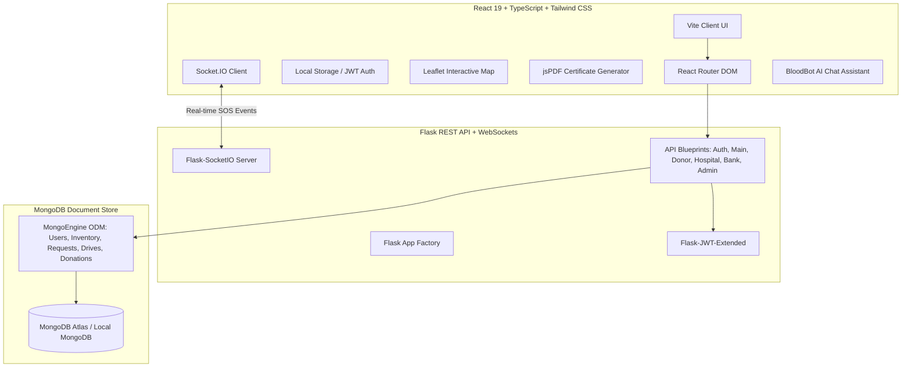

# 🩸 BloodBridge: Smart Emergency Blood Matching & Inventory Management Platform

> **A real-time, cloud-enabled healthcare platform bridging the critical gap between blood donors, hospitals, and blood banks to save lives without delay.**

---

## 📌 Table of Contents
1. [Project Overview & Vision](#-project-overview--vision)
2. [Key Problem Statement & Solution](#-key-problem-statement--solution)
3. [System Architecture](#-system-architecture)
4. [Technology Stack](#-technology-stack)
5. [Stakeholders & User Roles](#-stakeholders--user-roles)
6. [Core Features & Innovations](#-core-features--innovations)
7. [Database Schema & Data Models](#-database-schema--data-models)
8. [REST API Documentation](#-rest-api-documentation)
9. [Installation & Setup Guide](#-installation--setup-guide)
10. [Default Credentials (Seed Data)](#-default-credentials-seed-data)
11. [Troubleshooting & FAQs](#-troubleshooting--faqs)

---

## 🌟 Project Overview & Vision
In critical medical situations such as trauma surgeries, accidents, organ transplants, and cancer treatments, every second matters. Traditional blood bank systems suffer from fragmented communications, outdated manual tracking, stock mismanagement, and delayed donor notifications.

**BloodBridge** transforms blood bank logistics by:
* Digitizing blood inventory management across regional blood banks.
* Enabling hospitals to broadcast instant **Emergency SOS Blood Requests**.
* Notifying compatible, geographically proximate donors in real time via **WebSockets**.
* Gamifying the blood donation journey to encourage recurring community participation.

---

## ⚡ Key Problem Statement & Solution

| Traditional Inefficiencies | The BloodBridge Solution |
| :--- | :--- |
| **Manual Phone Calls:** Hospitals call multiple blood banks during acute shortages. | **One-Click SOS Broadcast:** Hospitals trigger an immediate broadcast across matching donors and blood banks. |
| **Lack of Donor Engagement:** Donors rarely know if their donation actually helped anyone. | **Live Blood Journey Tracker:** 5-stage real-time progress tracker (Donated $\rightarrow$ Tested $\rightarrow$ Stored $\rightarrow$ Dispatched $\rightarrow$ Life Saved). |
| **Paper-Based Records & Delays:** Blood stock counts are inaccurate and prone to expiration. | **Digital Live Inventory & AI Forecasting:** Real-time stock counts with shortage trend analysis. |
| **Lack of Recognition:** Donors receive little or no immediate appreciation. | **Gamification & PDF Certificates:** Automated downloadable appreciation certificates + bronze/silver/gold badges. |

---

## 🏗️ System Architecture



---

## 💻 Technology Stack

### 🎨 Frontend
* **Core Framework:** React 19 with TypeScript
* **Build Tool:** Vite 8
* **Styling:** Tailwind CSS 3.4 (with custom `@layer base`, custom fonts, and glassmorphism)
* **Animations:** Framer Motion (smooth transitions, floating indicators, modal animations)
* **Icons:** Lucide React
* **Maps & Geolocation:** Leaflet & React-Leaflet (5km coverage radius and interactive pins)
* **Charts & Analytics:** Recharts (Area charts for demand/supply shortage forecasting)
* **Real-time Client:** Socket.IO Client
* **Certificate & Document Generation:** `jsPDF` & `html2canvas`
* **QR Codes:** `qrcode.react` (blood unit batch tracking)
* **HTTP Client:** Axios (with Bearer Token request interceptor)

### ⚙️ Backend
* **Language & Framework:** Python 3.12 with Flask 2.3+
* **ODM (Object-Document Mapper):** Flask-MongoEngine 1.0 (MongoDB connection)
* **Authentication:** Flask-JWT-Extended (JSON Web Tokens with 24-hour expiration)
* **Real-time Engine:** Flask-SocketIO (WebSocket server with cross-origin support)
* **CORS:** Flask-CORS
* **Security:** Werkzeug password hashing (`generate_password_hash`, `check_password_hash`)

### 🗄️ Database
* **Database Engine:** MongoDB (via MongoDB Atlas or Local Community Server)
* **Document Models:** User, Hospital, BloodBank, BloodInventory, BloodRequest, EmergencyRequest, BloodDrive, Donation, DriveRegistration, Notification

---

## 👥 Stakeholders & User Roles

### 1. 🦸‍♂️ Blood Donor
* View personal donation history and upcoming eligible donation dates.
* Track donated blood units in real-time through the **Live Blood Journey Tracker**.
* Download official **Certificates of Appreciation** (PDF) with authorized signatory.
* Earn **Trophies & Badges** (Bronze Saver, Silver Hero, Gold Lifesaver).
* Receive instantaneous emergency notifications matching blood group.
* Chat with **BloodBot** to evaluate eligibility, medical criteria, and preparation tips.

### 2. 🏥 Hospital
* Post standard and critical emergency blood requests specifying required blood group and units.
* **Broadcast Emergency SOS Alerts** to all registered compatible donors via Socket.IO.
* Explore the **Regional Donor Map (Leaflet)** showing nearby donors within a 5km radius.
* Monitor live status (`PENDING`, `ACCEPTED`, `FULFILLED`, `REJECTED`) of blood requisitions.

### 3. 🩸 Blood Bank
* Maintain real-time stock levels across all 8 blood groups (A+, A-, B+, B-, AB+, AB-, O+, O-).
* Add and decrement units with instant color-coded threshold alerts (`good`, `low`, `critical`).
* Schedule and manage regional **Blood Donation Camps / Drives**.
* Generate verifiable **QR Codes** for blood units and transit verification.
* Review predictive **AI Shortage Forecasting charts** comparing demand vs. supply.

### 4. 🛡️ System Administrator
* Platform-wide overview of pending blood requests, donations, drives, and total registered donors.
* Approve or reject hospital blood requests with automatic inventory deduction.
* Accept and verify donor donations with automated credit to inventory.

---

## 🚀 Core Features & Innovations

### 1. 🚨 Real-time Emergency SOS Broadcast
* When a hospital raises an emergency request, the backend immediately triggers `socketio.emit('emergency_alert', ...)`.
* Connected donor clients receive a high-priority, animated fullscreen SOS overlay with hospital distance, contact details, and one-click response.

### 2. 🗺️ Interactive Regional Donor Map
* Leaflet map centered at the medical hub (e.g. Pune City) rendering a 5 km coverage perimeter.
* Custom pins for hospitals and matching donors with blood group badges and distance calculation.

### 3. 📦 5-Stage Live Blood Journey Tracker
* Visual breadcrumb illustrating the life-cycle of donated blood:
  1. **Donated** (Collection time & camp)
  2. **Lab Tested** (Serology, viral screening, test pass status)
  3. **Stored** (Cold chain inventory storage)
  4. **Dispatched** (Transit to surgery / hospital)
  5. **Saved a Life** (Completion milestone)

### 4. 🏆 Gamification & Rewards
* Level progression (e.g. Level 3 Donor) based on total donation count.
* Milestone badges: *Bronze Saver* (1st Donation), *Silver Hero* (3 Donations), *Gold Lifesaver* (10 Donations).

### 5. 📜 Automated PDF Certificate Generation
* Seamless browser-side PDF rendering using `html2canvas` and `jsPDF`.
* Generates an official, bordered certificate displaying the donor's full name, donation date, hospital/camp location, and authorized signatures.

### 6. 🤖 BloodBot AI Chat Assistant
* Floating responsive interactive assistant answering frequent donation inquiries:
  * Health & weight eligibility criteria.
  * Recent tattoo & travel wait periods.
  * Donation process timing and recovery tips.

---

## 🗃️ Database Schema & Data Models

### 1. `User` (Collection: `users`)
* `email` (String, unique, required)
* `password_hash` (String)
* `first_name` (String), `last_name` (String)
* `phone` (String), `address` (String)
* `role` (String: `admin`, `donor`, `hospital`, `blood_bank`)
* `is_active` (Boolean, default: True)
* `blood_type` (String: `A+`, `A-`, `B+`, `B-`, `AB+`, `AB-`, `O+`, `O-`)
* `created_at` (DateTime)

### 2. `Hospital` & `BloodBank` (Inherit from `User`)
* Extends `User` with institution `name`.

### 3. `BloodInventory` (Collection: `blood_inventory`)
* `blood_bank` (Reference to `BloodBank`)
* `blood_type` (String, required)
* `units_available` (Int, default: 0)
* `last_updated` (DateTime)

### 4. `BloodRequest` (Collection: `blood_requests`)
* `hospital` (Reference to `Hospital`)
* `blood_type` (String)
* `units_needed` (Int)
* `priority` (String: `CRITICAL`, `HIGH`, `MEDIUM`, `LOW`)
* `status` (String: `PENDING`, `ACCEPTED`, `FULFILLED`, `REJECTED`)
* `patient_details` (String)
* `deadline` (DateTime)

### 5. `BloodDrive` (Collection: `blood_drives`)
* `blood_bank` (Reference to `BloodBank`)
* `title` (String), `location` (String), `description` (String)
* `start_date` (DateTime), `end_date` (DateTime)
* `target_donors` (Int), `blood_types_needed` (String)
* `status` (String: `scheduled`, `active`, `completed`)

### 6. `Donation` (Collection: `donations`)
* `donor` (Reference to `User`)
* `blood_drive` (Reference to `BloodDrive`, optional)
* `blood_type` (String), `units` (Int, default: 1)
* `status` (String: `pending`, `COMPLETED`, `rejected`)
* `donation_date` (DateTime)

### 7. `Notification` (Collection: `notifications`)
* `user` (Reference to `User`)
* `message` (String)
* `is_read` (Boolean, default: False)
* `related_request` (Reference to `BloodRequest`)
* `created_at` (DateTime)

---

## 📡 REST API Documentation

### Authentication (`/api/auth`)
| Method | Endpoint | Description | Auth Required |
| :--- | :--- | :--- | :--- |
| `POST` | `/api/auth/register/<user_type>` | Register a `donor`, `hospital`, or `blood_bank` | No |
| `POST` | `/api/auth/login` | Authenticate user and issue JWT Bearer Token | No |
| `GET` | `/api/auth/me` | Fetch currently authenticated user profile | Bearer Token |

### Main Public Services (`/api/main`)
| Method | Endpoint | Description | Auth Required |
| :--- | :--- | :--- | :--- |
| `GET` | `/api/main/home` | Summary statistics, urgent requests, and upcoming drives | No |
| `GET` | `/api/main/blood-drives` | Paginated listing of public blood donation camps | No |
| `GET` | `/api/main/emergency-requests`| Listing of critical urgent blood requirements | No |
| `GET` | `/api/main/blood-inventory` | Aggregated blood stock availability across regions | No |

### Donor Services (`/api/donor`)
| Method | Endpoint | Description | Auth Required |
| :--- | :--- | :--- | :--- |
| `GET` | `/api/donor/dashboard` | Donor history, eligible next date, registered drives | JWT (Donor) |
| `POST` | `/api/donor/schedule-donation` | Schedule upcoming donation date (validates 56-day gap) | JWT (Donor) |
| `POST` | `/api/donor/register-drive/<id>` | Register for a scheduled blood donation camp | JWT (Donor) |
| `GET` | `/api/donor/notifications` | Fetch unread notifications and SOS alerts | JWT (Donor) |
| `PUT` | `/api/donor/notifications/<id>/read` | Mark emergency notification as read | JWT (Donor) |

### Hospital Services (`/api/hospital`)
| Method | Endpoint | Description | Auth Required |
| :--- | :--- | :--- | :--- |
| `GET` | `/api/hospital/dashboard` | Recent requests history and completed blood units | JWT (Hospital) |
| `POST` | `/api/hospital/create-request` | Create standard blood request with inventory check | JWT (Hospital) |
| `POST` | `/api/hospital/create-emergency-request` | Create critical request & broadcast Socket.IO alert | JWT (Hospital) |

### Blood Bank Services (`/api/blood-bank`)
| Method | Endpoint | Description | Auth Required |
| :--- | :--- | :--- | :--- |
| `GET` | `/api/blood-bank/dashboard` | Current stock counts, low stock alerts, camps | JWT (Bank/Admin) |
| `POST` | `/api/blood-bank/update-inventory` | Set / update available units for specific blood group | JWT (Bank) |
| `POST` | `/api/blood-bank/schedule-drive` | Schedule new blood donation drive | JWT (Bank/Admin) |

### Admin Services (`/api/admin`)
| Method | Endpoint | Description | Auth Required |
| :--- | :--- | :--- | :--- |
| `GET` | `/api/admin/dashboard` | System stats, pending approvals, total donor count | JWT (Admin) |
| `POST` | `/api/admin/blood-request/<id>/<action>` | Accept or Reject request (syncs inventory) | JWT (Admin) |
| `POST` | `/api/admin/donation/<id>/<action>` | Accept or Reject donation (increments inventory) | JWT (Admin) |

---

## 🛠️ Installation & Setup Guide

### Prerequisites
* Python 3.10+ (Recommended: Python 3.12)
* Node.js 18+ and `npm`
* MongoDB Atlas account OR local MongoDB Community Server installed

---

### Step 1: Clone the Repository
```bash
git clone <repository-url>
cd BloodBrige_Project
```

---

### Step 2: Configure Environment Variables
Create a `.env` file in the project root:
```env
# Flask Secret Key
SECRET_KEY=d49f9a6b4fd10aef72697d037bddc087705cc09eb27fd9f3e6a08cb2138c9df2

# MongoDB Connection String (Atlas or Localhost)
# For MongoDB Atlas:
MONGODB_URI=mongodb+srv://<username>:<password>@cluster0.mongodb.net/bloodbridge?retryWrites=true&w=majority

# Or For Local MongoDB:
# MONGODB_URI=mongodb://localhost:27017/bloodbridge
```

---

### Step 3: Backend Setup
1. Activate a virtual environment (optional but recommended):
   ```bash
   python -m venv venv
   .\venv\Scripts\activate   # On Windows
   source venv/bin/activate  # On Linux/macOS
   ```
2. Install Python dependencies:
   ```bash
   pip install -r requirements.txt
   ```
3. Initialize and seed test database:
   ```bash
   python init_db.py
   ```
4. Start the Flask backend server:
   ```bash
   python run.py
   ```
   *The backend will start at `http://localhost:5000`.*

---

### Step 4: Frontend Setup
1. Open a new terminal and navigate to the frontend folder:
   ```bash
   cd frontend
   ```
2. Install Node dependencies:
   ```bash
   npm install
   ```
3. Start the development server:
   ```bash
   npm run dev
   ```
   *The frontend will run at `http://localhost:5173`.*

4. To test a production build:
   ```bash
   npm run build
   ```

---

## 🔑 Default Credentials (Seed Data)

After running `python init_db.py`, you can test each stakeholder role using the following credentials:

| Role | Email | Password | Primary Features |
| :--- | :--- | :--- | :--- |
| **Admin** | `admin@gmail.com` | `admin@123` | System stats, request/donation approvals |
| **Blood Bank** | `bloodbank@example.com` | `bank123` | Inventory sync, camp scheduling, AI forecast |
| **Hospital** | `hospital@example.com` | `hospital123` | Emergency SOS broadcast, 5km donor map |
| **Donor** | `donor@example.com` | `donor123` | Blood tracker, certificate PDF, rewards |

---

## ❓ Troubleshooting & FAQs

#### 1. `dns.resolver.NXDOMAIN: The DNS query name does not exist`
* **Cause:** The MongoDB Atlas cluster is either paused/deleted, or your network's DNS cannot resolve `_mongodb._tcp` SRV records.
* **Solution:**
  * Visit [MongoDB Atlas](https://cloud.mongodb.com), verify cluster status (click **Resume** if paused), and update your `MONGODB_URI` in `.env`.
  * Alternatively, use a local MongoDB instance by setting `MONGODB_URI=mongodb://localhost:27017/bloodbridge` in `.env`.

#### 2. `Eventlet is deprecated` warning on backend startup
* This is an advisory warning from `engineio`/`eventlet` and does not stop the server from functioning normally.

#### 3. Frontend port conflict
* By default, Vite runs on `http://localhost:5173`. Ensure port 5000 is open for the Flask backend API and WebSocket connections.

---

## 📄 License
This project is developed for educational, healthcare, and research purposes. All rights reserved.
